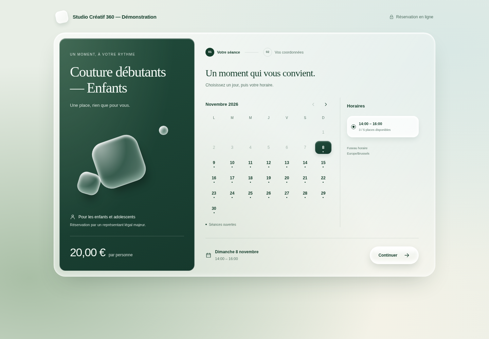
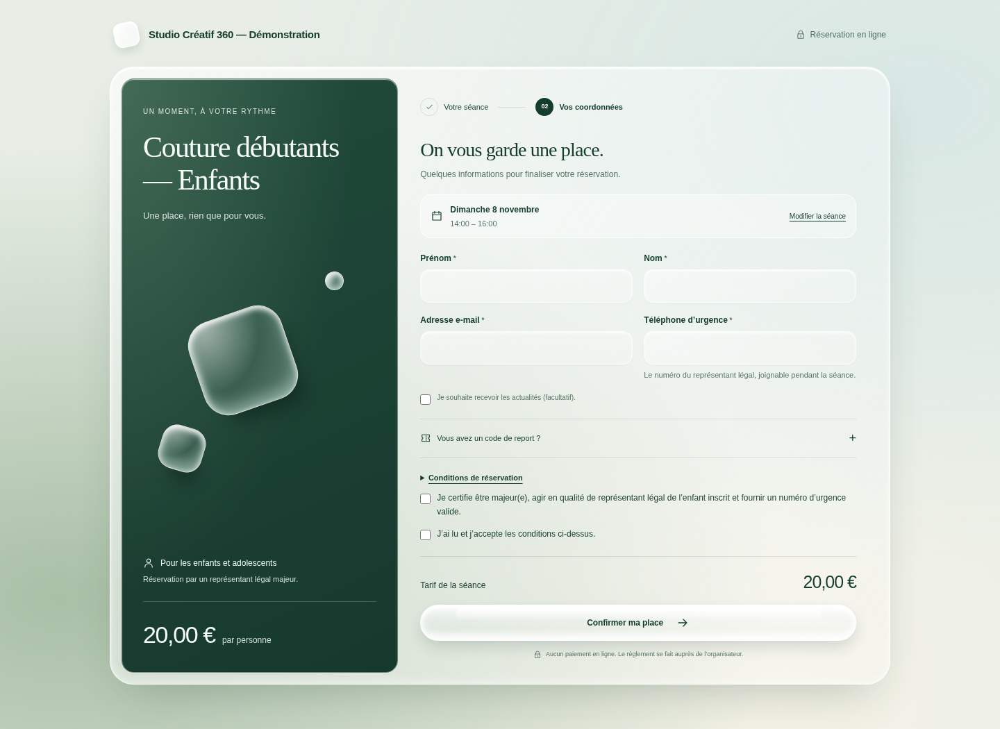
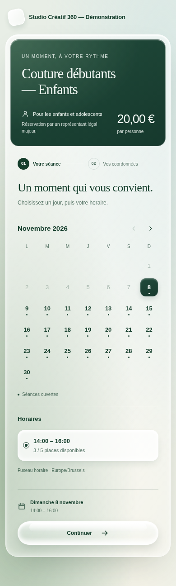
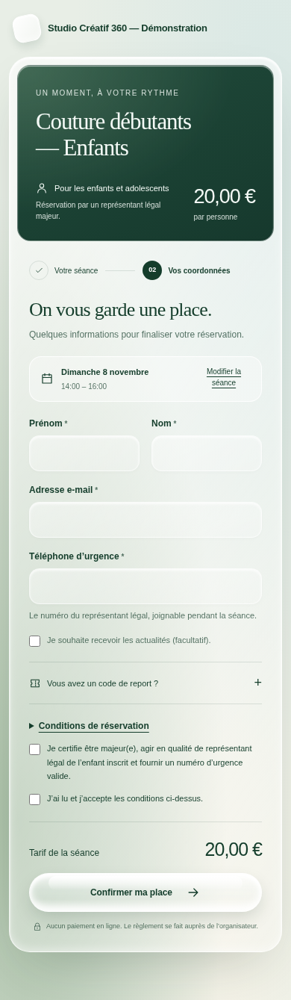

# Interface Liquid Ice

La page de réservation utilise un panneau d’activité vert sapin, une surface translucide et des capsules avec reflets. Les rayons, couleurs et effets restent définis dans les feuilles CSS. Le rendu ne nécessite aucune police distante ni bibliothèque de composants supplémentaire.

## Parcours

1. Un calendrier mensuel affiche les jours ouverts dans le fuseau de l’organisateur. Le client choisit un jour puis un horaire, avec le compteur de places disponibles.
2. Le récapitulatif conserve la date et l’horaire. Le client remplit ses coordonnées, vérifie son éventuel report puis accepte les conditions et l’attestation.
3. Le serveur valide le prix, les conditions et la capacité avant de réserver. Le mode sans paiement en ligne n’est pas présenté comme un encaissement. Les paiements par carte et virement disposent de libellés distincts ; une séance gratuite ou couverte par un report demande une confirmation sans paiement.

Les coordonnées sont conservées lors d’un retour au calendrier. Le téléphone d’urgence et l’explication relative au représentant légal concernent les activités pour mineurs. Une activité pour adultes peut exiger un téléphone de contact sans afficher cette explication.

La vérification du report n’en consomme pas la valeur : le montant affiché provient de l’API de devis. Une modification du code invalide le devis précédent ; un code invalide ou en cours de vérification bloque la confirmation jusqu’à sa correction ou son retrait. La consommation reste contrôlée dans la transaction serveur.

## Accessibilité et adaptations

Les champs ont des libellés associés et des aides reliées. Les jours du calendrier et les commandes restent des boutons natifs ; les horaires utilisent des radios et les consentements des cases natives. Le focus rejoint le titre de l’étape après navigation, puis le résultat après soumission. Le parcours mobile testé ne déborde pas horizontalement. Les préférences de réduction des animations sont respectées.

Les composants et fonctions TypeScript gardent les limites de taille du projet. Les styles sont répartis entre scène, composition, calendrier, champs, report, paiement et résultat, avec moins de 200 lignes par feuille CSS.

## Captures réelles

Captures du build de production local dans Chromium, avec des données fictives. Le nombre de places reflète les réservations présentes dans cette base de démonstration.

### Ordinateur — sélection de séance

### Ordinateur — coordonnées

### Mobile — sélection de séance

### Mobile — coordonnées

