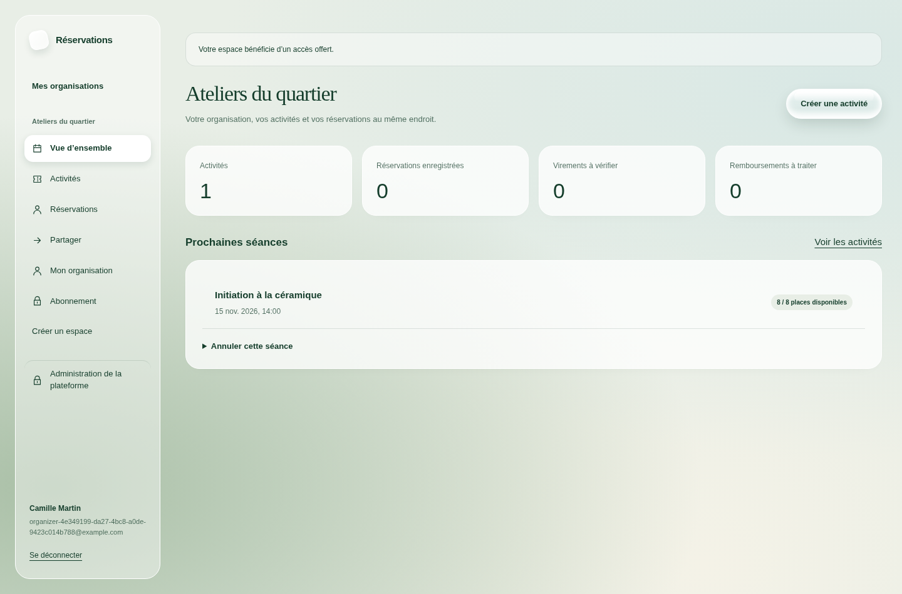
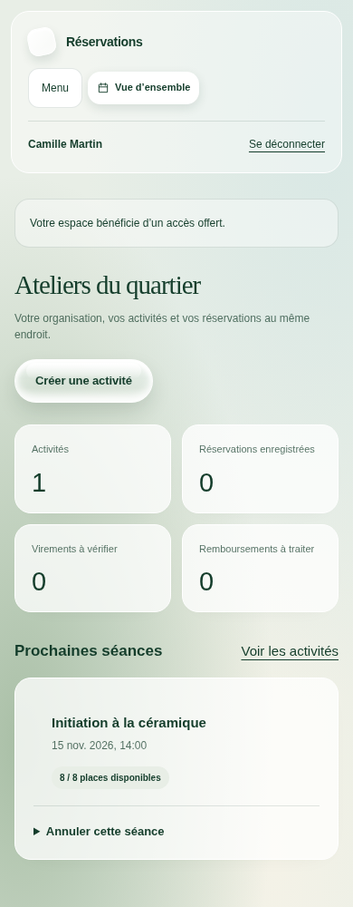
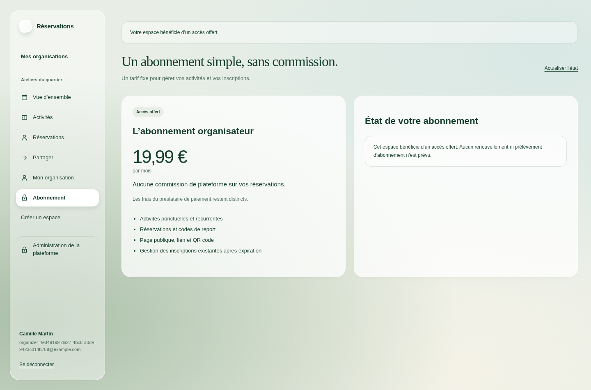
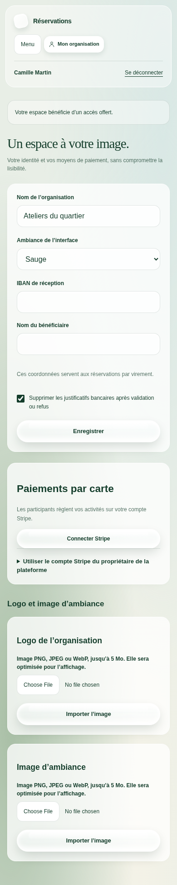
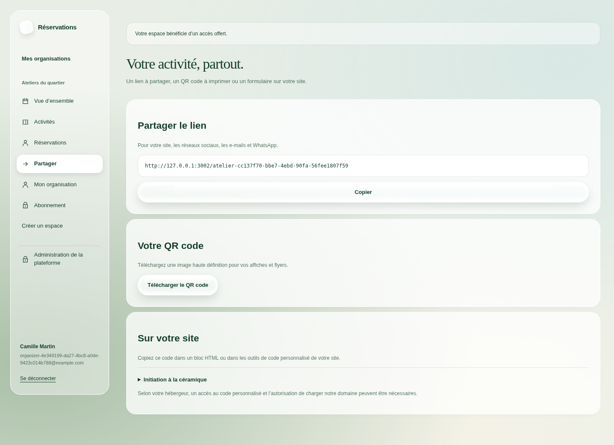
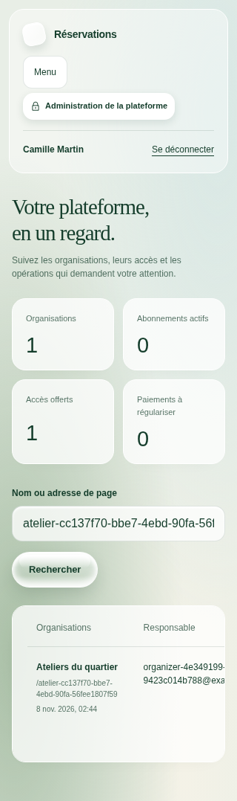
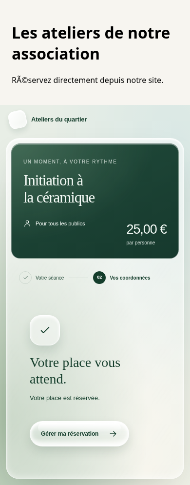

# Vérification des espaces SaaS

Branche `feat/saas-portals`, 8 novembre 2026. La PR précédente a été fusionnée dans `main` au commit `3b330f8` avant le démarrage de cette branche. Cette nouvelle version est proposée séparément et n’est pas fusionnée automatiquement.

## Résultats

| Contrôle | Résultat |
| --- | --- |
| `npm run verify` | TypeScript et ESLint sans erreur ; 35 tests unitaires réussis. |
| PostgreSQL 17 local | 41 tests d’intégration réussis, dont 17 nouveaux scénarios par rapport au moteur initial. |
| Compilation Next.js | Réussie ; toutes les nouvelles routes et consoles compilées. |
| Chromium sur compilation de production | Neuf parcours réussis, dont six nouveaux pour les espaces et l’intégration. |
| `npm audit --json` | Zéro vulnérabilité signalée au moment du contrôle, dépendances de développement incluses. |
| Taille et architecture | Tous les fichiers TypeScript et CSS sous 200 lignes ; fonctions TypeScript sous 40 lignes ; frontières de couches et absence de `any` contrôlées. |

## Parcours effectivement vérifiés

- Inscription via Better Auth, refus avant vérification de l’e-mail, vérification du lien, session réelle par cookie et refus d’un cookie falsifié. La récupération du mot de passe révoque les anciennes sessions et invalide l’ancien mot de passe.
- Création d’une organisation par le navigateur, attribution d’un accès offert depuis la console plateforme, puis création et publication d’une activité par le navigateur. Les écritures sont présentes dans PostgreSQL.
- Isolation entre organisations ; un gestionnaire peut gérer les activités, mais pas les paramètres du propriétaire ou les privilèges plateforme. Les mutations web refusent une origine étrangère.
- Résiliation arrêtant seulement le renouvellement, échéance conservée, reprise sans second Checkout ; refus d’un prix mensuel différent de 19,99 EUR. Les requêtes concurrentes ne créent pas plusieurs sessions de souscription.
- Signature réelle des événements Stripe générée par le SDK, déduplication, relecture canonique et protection contre un ancien abonnement. Les événements d’abonnement sont ignorés par le webhook des billets.
- État OAuth Stripe lié au compte et à l’organisation, expiration, usage unique et refus d’un autre utilisateur. Les mises à jour de compte relisent Stripe ; une révocation ferme les nouveaux encaissements par carte.
- Images réellement décodées et réencodées, refus d’images tronquées et d’un autre membre, purge après remplacement et récupération d’un échec d’envoi par une tâche durable. Une image encore utilisée est préservée.
- Accès complet pendant la période payée malgré une résiliation immédiate ; refus des créations après l’échéance, réservations publiques fermées et compte conservé pour gérer l’historique.
- QR code PNG réellement produit, écrans à 1440, 390 et 320 pixels sans débordement horizontal de la page, navigation mobile et conservation des coordonnées du parcours de réservation.
- Script d’intégration chargé depuis un autre domaine local : vrai formulaire, passage aux coordonnées, réservation persistée, confirmation, redimensionnement et refus de messages étrangers. Ouverture/fermeture du bouton flottant et refus d’intégrer les consoles privées dans une iframe.

## Conditions et limites

Les contrôles utilisent uniquement la base locale jetable `booking_test` et des données fictives. Les tests d’abonnement font fonctionner le SDK Stripe avec un transport HTTP de test ; ils n’effectuent aucune facturation réelle. Les liens d’identité sont capturés par un expéditeur de test, sans envoi d’e-mail à un tiers. Les images et fichiers sont contrôlés avec des adaptateurs de stockage de test.

Les scénarios navigateur utilisent de vrais comptes vérifiés préparés uniquement dans la base de test et l’authentification normale de l’application. Aucune route de contournement n’existe en production. Le test visuel de devis de report utilise une réponse API simulée ; ses transactions restent vérifiées séparément dans PostgreSQL.

La mise en service exige les paramètres réels de base, hébergement, messagerie, stockage et Stripe, puis une recette avec leurs environnements de test. Les paramètres fiscaux et les règles juridiques restent à valider pour l’exploitant. Le moteur conserve son horizon public maximal d’un an ; les séances manuelles sont prioritaires dans cet horizon. Aucun paiement réel, déploiement ou changement de base de production n’a été effectué.

## Captures réelles

Les images proviennent du navigateur local, avec une organisation de test bénéficiant d’un accès offert. Les compteurs correspondent à ses données de test, sans indicateurs inventés.

### Vue organisateur — ordinateur

### Vue organisateur — téléphone

### Abonnement — ordinateur

### Personnalisation — téléphone

### Partage — ordinateur

### Administration de plateforme — téléphone

Le tableau garde ses colonnes et défile à l’intérieur de son cadre sur un petit écran.

### Intégration sur un site externe — téléphone

